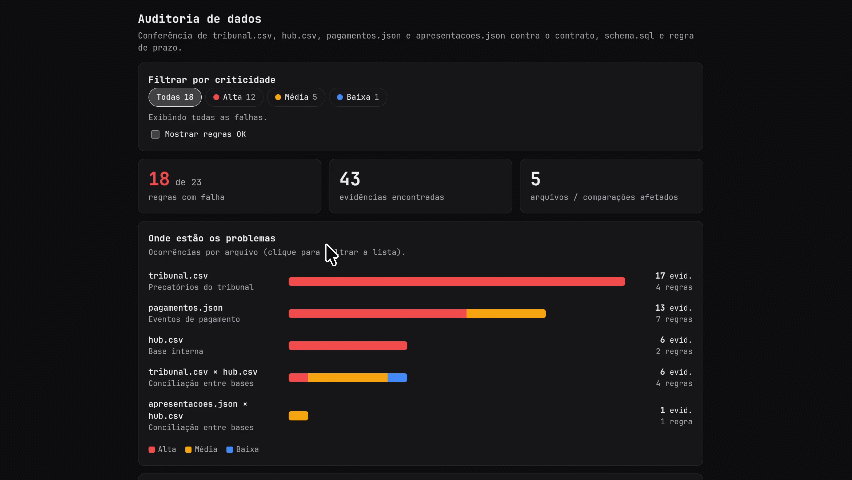

# Case BZR Group - Conciliação e Limpeza de Precatórios

## Problema

A operação identificou que os números do sistema interno não batem com os do tribunal — envolvendo divergências no cadastro dos precatórios ([tribunal.csv](./data/tribunal.csv) × [hub.csv](./data/hub.csv)), no cálculo dos prazos [apresentacoes.json](./data/apresentacoes.json) e na contabilização dos pagamentos [pagamentos.json](./data/pagamentos.json) — mas ainda não sabe exatamente onde estão os erros nem por que acontecem.

Meu papel como engenheiro é fazer uma investigação para encontrar o que está causando o problema, desenvolver uma solução com base em evidências concretas e impedir que o problema aconteça novamente.

## Abordagem

Para investigar o problema, optei por construir uma ferramenta determinística por três motivos:

- **Confiabilidade:** o código testa cada regra exata e prova qual registro violou o contrato.
- **Reprodutibilidade:** qualquer pessoa que rodar o script vai enxergar exatamente as mesmas evidências.
- **Escalabilidade:** neste case temos arquivos pequenos, mas em produção podem chegar 600 mil linhas — não dá para analisar manualmente nem confiar cegamente em IA lendo dados brutos (que pode errar contas/alucinar além de gastar tokens à toa).

As referências usadas como base para o script foram: as regras de contrato em [DOCUMENTACAO_TRIBUNAL.md](./docs/DOCUMENTACAO_TRIBUNAL.md), o fluxo operacional e regras de negócio em [ENUNCIADO.md](./docs/ENUNCIADO.md), e a modelagem interna do banco em [schema.sql](./schema.sql).

Por isso, fiz um script de auditoria para identificar e visualizar essas inconsistências automaticamente, embasando o diagnóstico completo.

### Critério de severidade

Para facilitar a leitura e a priorização das evidências na auditoria, defini três níveis de severidade por regra ([base.py](./src/bzr_group_case/auditoria/base.py)):

- **ALTA:** impacto financeiro direto, prazo legal incorreto ou bloqueio de leitura/carga dos arquivos.
- **MEDIA:** inconsistência cadastral, quebra de contrato de campo ou divergência entre bases.
- **BAIXA:** diferença de formatação contornável por normalização.

A severidade no script classifica o risco potencial de cada regra; a priorização final e a relação entre causa e consequência ficam no diagnóstico.

### Visualização da auditoria

Após rodar o script (`make audit-html`), posso visualizar os dados organizados e agrupados por origem das evidências para montar o diagnóstico — mapeando os principais problemas, o que é causa ou consequência e o impacto que isso traz para o negócio.

