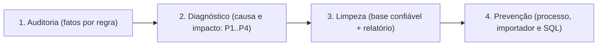

# Case BZR Group - Conciliação e Limpeza de Precatórios

## Problema

A operação identificou que os números do sistema interno não batem com os do tribunal — tanto nos saldos pagos quanto nos prazos de vencimento e no cadastro dos precatórios — mas ainda não sabe exatamente onde estão os erros nem o que os causa.

Como não temos acesso ao código do script de importação em produção nem ao banco em execução, partimos dos **dados brutos** recebidos ([tribunal.csv](./data/tribunal.csv), [hub.csv](./data/hub.csv), [apresentacoes.json](./data/apresentacoes.json) e [pagamentos.json](./data/pagamentos.json)), da documentação de integração ([DOCUMENTACAO_TRIBUNAL.md](./docs/DOCUMENTACAO_TRIBUNAL.md)), do fluxo operacional descrito no [ENUNCIADO.md](./docs/ENUNCIADO.md) e da modelagem do banco ([schema.sql](./schema.sql)).

O objetivo está dividido em três entregas práticas:
1. **Investigar e diagnosticar** onde e por que os números divergem, com evidências concretas e impacto no negócio.
2. **Limpar os dados atuais** (sem alterar os arquivos originais em `data/`) para gerar uma base confiável e um relatório rastreável.
3. **Propor prevenção** no processo operacional, no script de importação e no banco de dados (SQL) para evitar que os problemas voltem.

## Abordagem

A linha de raciocínio segue quatro etapas encadeadas — separando a **coleta de fatos** da **interpretação de causa e impacto** antes de aplicar qualquer correção:

1. **Auditoria dos dados contra as regras (fatos):** primeiro levantei objetivamente o que estava quebrado nos dados brutos, confrontando os quatro arquivos contra a documentação do tribunal, as regras de negócio do enunciado, as restrições do `schema.sql` e o cruzamento entre as bases. Por exemplo: como a documentação define que `evento_id` é único, o script testa essa regra em `pagamentos.json` e aponta exatamente os registros duplicados. A auditoria registra apenas fatos (`OK` ou `FALHA`), sem misturar gravidade na coleta.
   - Optei por um script **determinístico** por três motivos: **confiabilidade** (prova exata de qual linha violou cada contrato), **reprodutibilidade** (qualquer execução gera as mesmas evidências) e **escalabilidade** (funciona tanto nos dados pequenos do case quanto em arquivos com centenas de milhares de linhas, sem depender de análise manual ou de IA lendo dados brutos).
2. **Diagnóstico por revisão humana (causa raiz e impacto):** a partir das evidências levantadas, cruzei os erros com o fluxo operacional descrito no enunciado para entender *onde* cada problema nasce, *o que é causa e o que é consequência* e *qual o impacto esperado para o negócio*, agrupando tudo em quatro problemas (`P1` a `P4`) ordenados por gravidade. No mesmo exemplo dos eventos duplicados em `pagamentos.json`, como o enunciado descreve que o script apenas soma cada valor importado (além de ser reexecutado em caso de falha) e o `schema.sql` não possui `UNIQUE(evento_id)`, o impacto esperado desse fluxo é inflar o total pago do processo — e a correção definitiva disso (como tornar o importador idempotente e adicionar travas no banco) entra nas propostas de prevenção.
3. **Limpeza dos dados atuais (sem alterar `data/`):** guiada pelo diagnóstico (`P1` a `P4`), a limpeza produz a base confiável de hoje com três destinos explícitos: **corrige automaticamente** o que é objetivo (registrando premissas adotadas), envia registros inválidos ou órfãos para descartados com motivo no relatório e marca divergências reais de cadastro como **`em_duvida`** (sem chutar qual base prevalece).
4. **Prevenção e dúvidas antes de produção:** com as causas mapeadas, proponho o que mudar no processo operacional, no importador e no banco de dados (com script SQL de prevenção), além de listar as perguntas que precisam de confirmação do tribunal e da operação antes de levar a limpeza para produção.

### Visualização da auditoria

Após rodar o script (`make audit-html`), o painel interativo em `docs/auditoria.html` exibe as validações e evidências ordenadas pelo nome do arquivo, com filtros combináveis por contrato/origem, status (`Somente falhas`, `Todas`, `Somente OK`) e busca livre por registro ou texto (como `ev-001`, `0023456` ou `UTF-8`), facilitando a investigação factual usada para montar o diagnóstico.

## Diagnóstico

Com as evidências da auditoria em mãos, escrevi o [DIAGNOSTICO.md](./docs/DIAGNOSTICO.md) pensando em quem precisa entender rápido o que está acontecendo e decidir o que corrigir primeiro:

- **Agrupamento por problema:** em vez de listar as 18 falhas técnicas soltas, consolidei os achados em 4 grandes problemas (`P1` a `P4`) ordenados do mais grave para o menos grave, deixando claro o impacto para o negócio e a cadeia de causa e consequência entre eles.
- **Evidências sem atrapalhar a leitura:** cada problema traz a explicação em texto direto e mantém as referências exatas (arquivo, registro e linha) em blocos expansíveis, além do apontamento para `make audit` e `make audit-html` para reproduzir todas as validações.
- **Ponte para a limpeza e prevenção:** a partir de cada problema levantado, já organizei o que precisa ser tratado na etapa de limpeza dos dados e o que mudar no processo operacional, no script de importação e no banco de dados para evitar que os erros voltem.
- **Dúvidas antes de produção:** separei o que precisa ser confirmado com o tribunal e com a operação nos pontos em que os dados sozinhos não bastam para tomar uma decisão segura (como divergências de valor de face, ente devedor e eventos incompletos).
