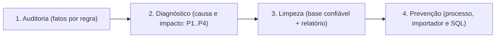

# Case BZR Group - Conciliação e Limpeza de Precatórios

## Problema

A operação identificou que os números do sistema interno não batem com os do tribunal (nos saldos pagos, nos prazos de vencimento e no cadastro dos precatórios), mas ainda não sabe exatamente onde estão os erros nem o que os causa.

Como não temos acesso ao código do script de importação em produção nem ao banco em execução, partimos dos **dados brutos** recebidos ([tribunal.csv](./data/raw/tribunal.csv), [hub.csv](./data/raw/hub.csv), [apresentacoes.json](./data/raw/apresentacoes.json) e [pagamentos.json](./data/raw/pagamentos.json)), da documentação de integração ([DOCUMENTACAO_TRIBUNAL.md](./docs/DOCUMENTACAO_TRIBUNAL.md)), do fluxo operacional descrito no [ENUNCIADO.md](./docs/ENUNCIADO.md) e da modelagem do banco ([schema.sql](./data/raw/schema.sql)).

O objetivo está dividido em três entregas práticas:

1. **Investigar e diagnosticar** onde e por que os números divergem, com evidências concretas e impacto no negócio.
2. **Limpar os dados atuais** sem alterar os arquivos originais, gerando uma base confiável e um relatório rastreável.
3. **Propor prevenção** no processo operacional, no script de importação e no banco de dados (SQL) para evitar que os problemas voltem.

## Demonstração

Para visualizar o **Antes** e o **Depois** de forma interativa, o projeto gera dois painéis HTML integrados (`docs/auditoria.html` e `docs/limpeza.html`) com filtros combináveis e busca livre.

<!-- TODO: Substituir o bloco abaixo pela URL do vídeo após subir pela interface web do GitHub
     (ex.: https://github.com/user-attachments/assets/<id-do-video>) em uma linha própria. -->

> **[Vídeo de demonstração]:** navegação pelos painéis de Auditoria (`Antes`) e Limpeza (`Depois`).

## Abordagem

A linha de raciocínio segue quatro etapas encadeadas, separando a **coleta de fatos** da **interpretação de causa e impacto** antes de aplicar qualquer correção:



Na prática, cada etapa alimenta a seguinte. Usando os pagamentos duplicados como exemplo: a **auditoria** detecta objetivamente que `evento_id` se repete em `pagamentos.json`; o **diagnóstico** cruza esse fato com o fluxo do enunciado (que apenas soma valores e é reexecutado em falhas) e com a ausência de `UNIQUE(evento_id)` no `schema.sql` para estimar o impacto de total pago inflado; a **limpeza** aplica idempotência sobre o lote atual sem tocar nos arquivos brutos; e a **prevenção** fecha a causa raiz no importador e no banco.

## Auditoria

Antes de interpretar causas ou propor correções, construí uma camada de auditoria determinística em [`src/bzr_group_case/auditoria/`](./src/bzr_group_case/auditoria/) para levantar fatos diretamente sobre `data/raw/`:

- **Por que determinística:** garante **confiabilidade** (prova exata de qual linha violou cada contrato), **reprodutibilidade** (toda execução gera as mesmas evidências) e **escalabilidade** (funciona tanto no lote do case quanto em bases grandes, sem depender de análise manual ou de IA lendo dados brutos).
- **Separação por contrato:** organizei as regras pela origem de cada expectativa (documentação do tribunal, regras de negócio do enunciado, restrições do `schema.sql` e conciliação entre as bases).
- **Fatos sem ruído:** cada validação devolve apenas `OK` ou `FALHA` com arquivo, registro e linha, sem misturar gravidade na coleta, e alimenta `docs/auditoria.html` com as 23 validações e 18 falhas usadas na etapa seguinte.

## Diagnóstico

Com as evidências da auditoria em mãos, escrevi o [DIAGNOSTICO.md](./docs/DIAGNOSTICO.md) pensando em quem precisa entender rápido o que está acontecendo e decidir o que corrigir primeiro:

- **Agrupamento por problema:** em vez de listar as 18 falhas técnicas soltas, consolidei os achados em 4 grandes problemas (`P1` a `P4`) ordenados do mais grave para o menos grave, deixando claro o impacto para o negócio e a cadeia de causa e consequência entre eles.
- **Evidências sem atrapalhar a leitura:** cada problema traz a explicação em texto direto e mantém as referências exatas (arquivo, registro e linha) em blocos expansíveis, conectadas às validações reproduzíveis da auditoria.
- **Ponte para a limpeza e prevenção:** a partir de cada problema levantado, já organizei o que precisa ser tratado na etapa de limpeza e o que mudar no processo operacional, no script de importação e no banco de dados (SQL) para evitar que os erros voltem.
- **Dúvidas antes de produção:** separei o que precisa ser confirmado com o tribunal e com a operação nos pontos em que os dados sozinhos não bastam para tomar uma decisão segura (como divergências de valor de face, ente devedor e eventos incompletos).

## Limpeza

A partir dos quatro problemas mapeados, estruturei o pipeline descrito por etapa e pasta no [FLUXO_LIMPEZA.md](./docs/FLUXO_LIMPEZA.md) para gerar uma base confiável em `data/clean/` mantendo `data/raw/` intacto:

- **Três destinos explícitos:** o pipeline corrige automaticamente o que é objetivo (formato, encoding, datas, chave CNJ, idempotência e prazo constitucional), marca divergências reais de cadastro como `em_duvida` sem chutar qual base prevalece em [precatorios_limpos.csv](./data/clean/precatorios_limpos.csv) e descarta eventos inválidos ou órfãos antes de gravar [pagamentos_limpos.csv](./data/clean/pagamentos_limpos.csv).
- **Rastreabilidade 1-para-1 e premissas:** nenhum registro some em silêncio. Todo item de entrada aparece no [relatorio_limpeza.md](./data/clean/relatorio_limpeza.md) com seu destino e motivo, destacando as duas premissas adotadas que dependem de confirmação antes de produção.
- **Validação automática do "Depois":** ao final, o pipeline relê os CSVs gravados no disco para confirmar os contratos de integridade e gera `docs/limpeza.html`, permitindo cruzar o resultado por processo, ocorrência ou problema (`P1` a `P4`).

## Como usei IA neste projeto

Usei agentes de IA (modelos Gemini 4 Neon e Opus 5.5, rodando pelo harness Antigravity CLI na interface gráfica T3 Code) para acelerar o entendimento do domínio, a implementação, a refatoração e a documentação. Encarei meu papel como o de um jardineiro cuidando do projeto: em vez de escrever cada linha manualmente, preparei o ambiente, a estrutura e os critérios de qualidade para que os agentes trabalhassem bem e o código não se contaminasse com padrões ruins.

- **Ambiente pensado para humanos e agentes:** organizei o repositório em módulos pequenos e previsíveis por responsabilidade (auditoria, limpeza, código compartilhado e painéis), com testes focados nas regras críticas e documentação do fluxo. Isso facilita a leitura humana e evita que um agente replique atalhos ou inconsistências.
- **Entender o porquê e podar excessos:** dividi o trabalho em etapas focadas, mantendo o controle das decisões. Sempre que algo ficou complexo, fugiu do combinado ou não ficou claro, pedi para o agente explicar por que escolheu aquele caminho. Com isso, consegui estudar conceitos novos, podar excessos (como testes redundantes, código duplicado e caminhos ruins para os quais eu mesmo havia guiado o agente) e ajustar o ambiente para evitar que os problemas se repetissem.

### Como conferi o que a IA produziu

Não li cada linha de código isoladamente. Adotei a mesma abordagem que funciona em projetos grandes, onde o código foi feito por outros desenvolvedores além de mim: entender claramente o que cada componente faz e validar comportamento e saídas.

- **Travas automatizadas de qualidade:** lint e formatação (`ruff`), checagem de tipos (`basedpyright`) e testes automatizados (`pytest`) cobrindo regras críticas, casos de borda e a preservação dos arquivos originais.
- **Loop de revisão entre agentes:** ao fim de cada entrega relevante, um subagente revisor em contexto isolado auditou código, lacunas de validação, UX dos painéis e aderência ao enunciado, devolvendo o feedback direto para o agente implementador corrigir. Só depois desse ciclo eu avaliava o resultado, evitando perder tempo com erros óbvios.
- **Análise crítica das saídas e proteção contra alucinações:** executei o pipeline sobre os dados reais para inspecionar o [DIAGNOSTICO.md](./docs/DIAGNOSTICO.md), a base limpa e o relatório em `data/clean/` e a navegação dos painéis interativos (`docs/auditoria.html` e `docs/limpeza.html`). Um ambiente bem preparado reduz a chance de alucinações chegarem à base, mas não elimina o risco por completo. Por isso, li o retorno de cada entrega com senso crítico, inclusive questionando premissas da própria validação automática até fechar brechas encontradas, para tomar a decisão final.

## Como executar

Requer **Python 3.10+** e [`uv`](https://docs.astral.sh/uv/) (sem dependências externas em runtime):

```bash
make sync        # instala ferramentas de dev (ruff, basedpyright, pytest)
make audit       # auditoria no terminal (make audit-html gera docs/auditoria.html)
make clean-data  # limpeza em data/clean/ (make clean-html gera docs/limpeza.html)
make check       # lint + typecheck + testes
```
