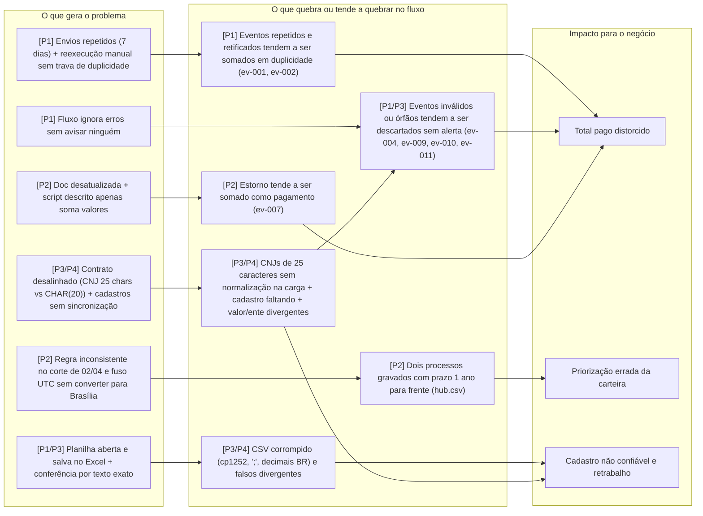

# Diagnóstico

Os números do sistema não batem com os do tribunal por quatro motivos principais: falhas no processo manual e no script de carga, regras de negócio aplicadas errado, arquivos fora do padrão combinado (com um banco incompatível) e divergências entre o cadastro do tribunal e o nosso cadastro interno.

Abaixo está o resumo ordenado do problema mais grave para o menos grave. Cada seção descreve o problema, o impacto para o negócio e a relação entre causa e consequência, com as evidências exatas (arquivo, registro e linha) organizadas em blocos expansíveis para manter a leitura fluida. Quem quiser conferir o relatório completo das 23 validações (18 falhas encontradas) pode rodar `make audit` ou gerar a versão visual com `make audit-html`.

## Visão geral

| Código | Criticidade | Problema | Impacto principal | Papel na cadeia |
| --- | --- | --- | --- | --- |
| `P1` | Crítica | Processo operacional e fluxo de importação frágeis | Risco de total pago inflado, perda silenciosa de pagamentos e retrabalho | Causa |
| `P2` | Crítica | Regras de negócio aplicadas de forma errada | Risco de estorno somado como pagamento e priorização errada da carteira | Causa |
| `P3` | Alta | Arquivos fora do padrão combinado e banco incompatível | Rejeição de dados válidos e perda silenciosa de registros | Causa e consequência |
| `P4` | Média | Divergência entre o cadastro do tribunal e o cadastro interno | Pagamentos sem vínculo, saldo a receber incerto e conferência manual falha | Consequência e causa |

## Como as causas se conectam aos problemas

---

## Detalhamento dos problemas

### P1. Processo operacional e fluxo de importação frágeis *(Crítica — Causa)*

Pelo fluxo operacional descrito no enunciado, todo dia o tribunal envia os pagamentos dos últimos 7 dias, então os mesmos eventos naturalmente voltam em vários arquivos. Além disso, quando a importação falha no meio, a operação roda o mesmo arquivo de novo. Como o script descrito apenas soma cada valor importado ao total pago do processo — e o banco também não impede duplicidades —, eventos repetidos ou retificados tendem a ser contabilizados mais de uma vez.

Para piorar, quando um evento não pode ser importado, o fluxo descrito apenas ignora o erro e segue em frente sem avisar ninguém. E na conferência semanal, abrir e salvar a lista do tribunal no Excel acaba corrompendo o formato original do arquivo.

**Impacto:** nesse fluxo, o total pago tende a ficar inflado (ao somar eventos repetidos e versões antigas) ou faltando dinheiro (ao descartar eventos inválidos/órfãos sem aviso), e a equipe perde tempo corrigindo planilhas manualmente.

**Causa ou consequência:** é a principal **causa** do risco de distorção no total pago, do descarte silencioso de pagamentos e da corrupção de formato da lista do tribunal.

Ver evidências (7 ocorrências — processo, arquivo, registro e linha)

- **[ENUNCIADO.md (L15–19)](./ENUNCIADO.md#L15-L19) · fluxo operacional descrito:** reenvio diário dos últimos 7 dias, script que soma cada valor e é reexecutado em caso de falha, edição/salvamento de `tribunal.csv` no Excel e descarte silencioso de eventos que falham na importação.
- **[pagamentos.json (L26–33)](../data/raw/pagamentos.json#L26-L33) · `ev-002`:** cópia idêntica do registro já enviado em [L10–17](../data/raw/pagamentos.json#L10-L17).
- **[pagamentos.json (L66–73)](../data/raw/pagamentos.json#L66-L73) · `ev-001`:** mesmo evento de [L2–9](../data/raw/pagamentos.json#L2-L9), atualizado no dia seguinte de R$ 15.000 para R$ 15.500 (somar ambos no fluxo descrito geraria R$ 30.500).
- **[pagamentos.json (L34–41)](../data/raw/pagamentos.json#L34-L41) · `ev-004`:** valor veio nulo — no fluxo descrito, tende a ser ignorado em silêncio.
- **[pagamentos.json (L82–105)](../data/raw/pagamentos.json#L82-L105) · `ev-009`, `ev-010`, `ev-011`:** valor negativo (`-200`), processo vazio e processo fora do hub — no fluxo descrito, tendem a ser descartados sem alerta.
- **[tribunal.csv (L1–6)](../data/raw/tribunal.csv#L1-L6) · cabeçalho + 5 registros:** salvo pelo Excel em `cp1252` (Windows-1252) / `Latin-1` (acentos fora de UTF-8), com `;` no lugar de `,` e valores como `45.000,00`.
- **[schema.sql (L11)](../data/raw/schema.sql#L11) · `pagamento.evento_id`:** sem trava de unicidade (`UNIQUE`) e sem coluna `atualizado_em` para identificar retificações.

---

### P2. Regras de negócio aplicadas de forma errada *(Crítica — Causa)*

Duas regras essenciais da operação apresentam falhas ou desalinhamento:

- **Estorno tratado como pagamento no contrato/fluxo:** a documentação do tribunal afirma que todo evento é sempre `"pagamento"` — contradizendo inclusive o próprio banco, que já prevê estornos (`('pagamento', 'estorno')`). Como o fluxo descrito no enunciado apenas soma cada valor importado sem diferenciar o tipo, um estorno tende a dobrar o total pago em vez de abater o valor.
- **Prazo constitucional inconsistente na borda de 2 de abril:** pela Constituição, precatórios apresentados **até 2 de abril (inclusive)** vencem em 31 de dezembro do ano seguinte. Em `hub.csv`, o sistema acertou quando a data veio com horário e fuso de Brasília, mas errou em dois cenários da mesma data: quando a apresentação veio sem horário/fuso e quando veio em horário UTC (1h da manhã do dia 3 em UTC ainda é 22h do dia 2 em Brasília).

**Impacto:** no fluxo descrito, processos estornados tendem a ficar com o dobro do valor pago; e, comprovadamente em `hub.csv`, dois precatórios que vencem no fim de 2026 estão marcados como se só vencessem em 2027 — distorcendo a prioridade da carteira.

**Causa ou consequência:** no prazo, o tratamento inconsistente de data e fuso é **causa** direta dos vencimentos errados gravados em `hub.csv`. No estorno, a documentação desatualizada combinada ao fluxo que apenas soma cada valor é **causa** do risco de total pago inflado.

Ver evidências (5 ocorrências — processo, arquivo, registro e linha)

- **[ENUNCIADO.md (L16)](./ENUNCIADO.md#L16) · fluxo de importação:** descreve que o script *"soma cada valor ao total pago do processo no sistema"*, sem distinção de estorno.
- **[pagamentos.json (L58–65)](../data/raw/pagamentos.json#L58-L65) · `ev-007`:** estorno de R$ 5.000 sobre o pagamento de R$ 5.000 em [L50–57](../data/raw/pagamentos.json#L50-L57); somar ambos gera R$ 10.000 em vez de R$ 0.
- **[DOCUMENTACAO_TRIBUNAL.md (L15)](./DOCUMENTACAO_TRIBUNAL.md#L15) × [schema.sql (L12)](../data/raw/schema.sql#L12) · campo `tipo`:** documentação afirma ser sempre `"pagamento"`, mas o banco já prevê `('pagamento', 'estorno')`.
- **[hub.csv (L2)](../data/raw/hub.csv#L2) · `0012345-10.2019.8.26.0053`:** apresentado em `2025-04-02` (sem horário), ficou com prazo `2027-12-31` (correto: `2026-12-31`; contraste com [L5](../data/raw/hub.csv#L5), que com `-03:00` calculou certo).
- **[hub.csv (L6)](../data/raw/hub.csv#L6) · `0056789-54.2017.4.03.6100`:** apresentado em `2025-04-03T01:00:00Z` (`02/04 22:00` em Brasília), ficou com prazo `2027-12-31` (correto: `2026-12-31`).

---

### P3. Arquivos fora do padrão combinado e banco incompatível *(Alta — Causa e consequência)*

Os arquivos que chegam para a operação não respeitam o leiaute documentado pelo tribunal — misturam formatos brasileiros de número e data, números de processo sem pontuação, campos vazios e valores negativos. Ao mesmo tempo, há um **desalinhamento de contrato** entre os arquivos/documentação e o banco de dados: os arquivos e o leiaute usam o padrão CNJ formatado com pontuação (25 caracteres), enquanto a coluna `precatorio.numero_processo` foi definida como `CHAR(20)` sem nenhuma etapa de normalização na carga para extrair os 20 dígitos puros. Além disso, faltam colunas no banco para guardar data de apresentação e prazo, e a documentação nem menciona o arquivo de apresentações.

**Impacto:** sem limpeza e normalização prévia, registros válidos correm risco de falhar na carga, e qualquer variação nos arquivos enviados pelo tribunal quebra o fluxo sem aviso.

**Causa ou consequência:** na lista do tribunal, o formato quebrado é **consequência** da edição manual no Excel (`P1`). Já o desalinhamento entre os arquivos de pagamento, a documentação e o banco é **causa** de rejeições e falhas silenciosas.

Ver evidências (7 ocorrências + 9 CNJs acima de 20 caracteres — arquivo, registro e linha)

- **[schema.sql (L3)](../data/raw/schema.sql#L3) · `precatorio.numero_processo`:** desalinhamento de contrato — definido como `CHAR(20)` sem normalização na carga, enquanto os arquivos e a documentação trazem o CNJ formatado com 25 caracteres (9 ocorrências nos arquivos de cadastro):
  - `0012345-10.2019.8.26.0053` em [tribunal.csv (L2)](../data/raw/tribunal.csv#L2) e [hub.csv (L2)](../data/raw/hub.csv#L2);
  - `0023456-21.2020.8.26.0053` em [tribunal.csv (L3)](../data/raw/tribunal.csv#L3);
  - `0034567-32.2018.8.26.0405` em [tribunal.csv (L4)](../data/raw/tribunal.csv#L4) e [hub.csv (L4)](../data/raw/hub.csv#L4);
  - `0045678-43.2021.5.02.0011` em [tribunal.csv (L5)](../data/raw/tribunal.csv#L5) e [hub.csv (L5)](../data/raw/hub.csv#L5);
  - `0067890-65.2016.8.26.0053` em [tribunal.csv (L6)](../data/raw/tribunal.csv#L6);
  - `0056789-54.2017.4.03.6100` em [hub.csv (L6)](../data/raw/hub.csv#L6).
- **[schema.sql (L1–6)](../data/raw/schema.sql#L1-L6) × [hub.csv (L1)](../data/raw/hub.csv#L1) · tabela `precatorio`:** não possui colunas `apresentado_em` e `prazo_pagamento`, embora o sistema calcule e exporte esses campos.
- **[pagamentos.json (L10–17)](../data/raw/pagamentos.json#L10-L17) · `ev-002` (e [L26–33](../data/raw/pagamentos.json#L26-L33)):** valor veio como texto brasileiro (`"2.500,50"`) e data como `"10/04/2025"` em vez de `AAAA-MM-DD`.
- **[pagamentos.json (L42–49)](../data/raw/pagamentos.json#L42-L49) · `ev-005`:** número do processo sem pontuação (`00234562120208260053`), diferente do padrão CNJ documentado.
- **[pagamentos.json (L34–41)](../data/raw/pagamentos.json#L34-L41) e [L90–97](../data/raw/pagamentos.json#L90-L97) · `ev-004` e `ev-010`:** valor nulo (`ev-004`) e número de processo vazio (`ev-010`).
- **[pagamentos.json (L82–89)](../data/raw/pagamentos.json#L82-L89) × [schema.sql (L13)](../data/raw/schema.sql#L13) · `ev-009`:** valor `-200` marcado como `"pagamento"`, violando `CHECK (valor > 0)`.
- **[DOCUMENTACAO_TRIBUNAL.md (L1–26)](./DOCUMENTACAO_TRIBUNAL.md#L1-L26) · Leiaute v2.1:** não documenta `apresentacoes.json`, retificações nem estornos.

---

### P4. Divergência entre o cadastro do tribunal e o cadastro interno *(Média — Consequência e causa)*

Ao cruzar a lista do tribunal, o cadastro interno e o arquivo de apresentações, aparecem dois tipos de diferença:

- **Falsos divergentes:** registros que representam a mesma coisa, mas escritos de jeitos diferentes (um com pontuação e outro sem; um com acento e outro tudo em maiúsculas). Como a operação compara texto exato no Excel, esses casos geram alertas falsos toda semana.
- **Divergências reais:** um processo tem valor de face diferente entre as bases, outro aponta devedores completamente distintos, um existe no tribunal mas não existe no nosso cadastro interno e outro existe no nosso sistema mas não consta na lista do tribunal.

**Impacto:** o processo que falta no nosso cadastro impede a entrada de um pagamento de R$ 4.000 (que fica órfão), o valor de face divergente distorce quanto ainda falta receber, o devedor trocado compromete a análise de risco e os falsos divergentes geram retrabalho semanal.

**Causa ou consequência:** é **consequência** da falta de sincronização entre as bases e da comparação manual por texto exato — e vira **causa** direta do bloqueio do pagamento `ev-011`.

Ver evidências (7 ocorrências — processo, arquivo, registro e linha)

- **[ENUNCIADO.md (L17)](./ENUNCIADO.md#L17) · conferência manual:** operador compara `tribunal.csv` e `hub.csv` procurando nome do ente e número do processo exatamente como estão escritos.
- **Falso divergente — [tribunal.csv (L3)](../data/raw/tribunal.csv#L3) × [hub.csv (L3)](../data/raw/hub.csv#L3) · `0023456-21.2020.8.26.0053`:** com máscara no tribunal e sem máscara no hub (`00234562120208260053`).
- **Falso divergente — [tribunal.csv (L2)](../data/raw/tribunal.csv#L2) × [hub.csv (L2)](../data/raw/hub.csv#L2) · `0012345-10.2019.8.26.0053`:** `Município de São Paulo` no tribunal vs. `MUNICIPIO DE SAO PAULO` no hub.
- **Valor diferente — [tribunal.csv (L3)](../data/raw/tribunal.csv#L3) × [hub.csv (L3)](../data/raw/hub.csv#L3) · `0023456-21.2020.8.26.0053`:** valor de face de R$ 30.000 no tribunal vs. R$ 31.000 no hub (+R$ 1.000).
- **Devedor diferente — [tribunal.csv (L5)](../data/raw/tribunal.csv#L5) × [hub.csv (L5)](../data/raw/hub.csv#L5) · `0045678-43.2021.5.02.0011`:** `União` no tribunal vs. `Município de Santos` no hub.
- **Falta no hub — [tribunal.csv (L6)](../data/raw/tribunal.csv#L6), [apresentacoes.json (L22–25)](../data/raw/apresentacoes.json#L22-L25) · `0067890-65.2016.8.26.0053`:** não existe no hub — por isso o pagamento `ev-011` de R$ 4.000 ([pagamentos.json L98–105](../data/raw/pagamentos.json#L98-L105)) fica sem vínculo.
- **Falta no tribunal — [hub.csv (L6)](../data/raw/hub.csv#L6), [apresentacoes.json (L18–21)](../data/raw/apresentacoes.json#L18-L21) · `0056789-54.2017.4.03.6100`:** existe no hub e nas apresentações, mas não aparece na lista do tribunal.

---

## Sugestões de melhoria e prevenção

### No processo operacional
1. **Parar de editar a lista do tribunal no Excel:** salvar o arquivo original em uma pasta de entrada protegida antes de qualquer leitura humana. Se a equipe quiser visualizar no Excel, abre uma cópia — nunca sobrescreve o arquivo usado na integração.
2. **Trocar a conferência semanal manual por uma conciliação automática:** em vez de o operador cruzar planilhas no olho toda semana, uma rotina automatizada compara a lista do tribunal com o cadastro interno após normalizar os campos e envia um relatório apenas com divergências reais (valor de face, ente devedor e processos faltantes em uma das bases).
3. **Criar rotina de revisão para erros:** nenhum registro com falha deve sumir. Qualquer evento rejeitado precisa disparar um resumo diário (e-mail ou Slack) para a operação atuar.
4. **Atualizar o acordo com o tribunal:** formalizar no documento de integração o uso de estornos, retificações de eventos já enviados e o arquivo de apresentações.

### No script de importação
1. **Permitir reexecução segura:** rodar o mesmo arquivo várias vezes precisa gerar sempre o mesmo resultado. Ao receber um evento já existente, o script ignora se for igual ou mais antigo, e atualiza apenas se a data de atualização for mais recente.
2. **Carregar tudo em uma transação única:** se algo falhar no meio do caminho, o banco desfaz a carga inteira para nunca deixar dados pela metade.
3. **Calcular o saldo a partir dos eventos:** em vez de ir somando em um contador, o total pago deve ser sempre calculado a partir do histórico — somando pagamentos e subtraindo estornos.
4. **Padronizar os dados na entrada:** limpar o número do processo para 20 dígitos puros antes de comparar ou salvar, normalizar o nome do ente (sem acento e em maiúsculas apenas na chave de comparação), tratar encoding e converter formatos brasileiros quando necessário, sempre registrando no log o que foi ajustado.
5. **Corrigir o cálculo do prazo:** converter a data de apresentação para o horário de Brasília (`America/Sao_Paulo`) — inclusive tratando datas sem hora como data civil de Brasília — e aplicar o corte incluindo o dia 2 de abril (`<= 02/04` vence no fim do ano seguinte; `> 02/04` vence dois anos depois).
6. **Usar fila de quarentena:** eventos com valor nulo, valor negativo, processo vazio ou processo não cadastrado vão para uma tabela de rejeitados com o motivo claro e geram alerta.

### No banco de dados
1. **Padronizar o número do processo em 20 dígitos puros:** trocar `CHAR(20)` por `VARCHAR(20)` (evitando preenchimento com espaços) com validação de exatamente 20 dígitos numéricos, deixando a máscara CNJ apenas para exibição.
2. **Armazenar apresentação e prazo no cadastro:** adicionar `apresentado_em`, `prazo_pagamento` e trava de `valor_face > 0` na tabela `precatorio`.
3. **Impedir pagamentos duplicados e suportar retificações:** adicionar `atualizado_em` (sem `DEFAULT now()`, preenchido a partir do histórico antes de ativar `NOT NULL`) e trava de unicidade (`UNIQUE`) em `pagamento.evento_id`, permitindo atualizar um evento apenas quando chegar versão mais recente.
4. **Acelerar e corrigir o cálculo de saldo:** criar índice na chave estrangeira `pagamento(precatorio_id)` e expor o total pago via consulta/view que soma pagamentos e subtrai estornos.
5. **Criar tabela de quarentena (`pagamento_rejeitado`):** registrar todo evento recusado com o motivo e o dado original, evitando alertas duplicados enquanto o mesmo evento se repete na janela móvel de 7 dias.
6. **Saneamento antes das travas em produção:** limpar e deduplicar os registros legados antes de ativar as novas restrições (`UNIQUE` e `CHECK`) em um banco já populado.

*(O script SQL completo dessas alterações será adicionado em `data/clean/001_prevencao_integridade.sql`.)*

---

## Dúvidas antes de colocar a limpeza em produção

### Para o tribunal
1. **Retificação de pagamento (`ev-001`):** quando o mesmo evento volta com data de atualização mais nova e valor alterado (de R$ 15.000 para R$ 15.500), podemos sempre substituir o valor anterior pelo mais recente?
2. **Valor negativo como pagamento (`ev-009`):** o valor `-200` marcado como pagamento é um estorno lançado com o tipo errado ou foi falha na exportação?
3. **Eventos incompletos (`ev-004` e `ev-010`):** o pagamento com valor nulo e o pagamento sem número de processo terão reenvio corrigido ou devem ser descartados?
4. **Processo ausente na lista semanal (`0056789-54.2017.4.03.6100`):** ele aparece no nosso cadastro e nas apresentações, mas não consta na lista do tribunal. Foi quitado, cancelado ou omitido por engano?
5. **Documentação e envio dos arquivos:** existe uma versão atualizada do leiaute que cubra estornos, retificações e o arquivo de apresentações? Há como receber os arquivos por um canal automatizado para não depender de e-mail e Excel?

### Para a operação
1. **Qual valor de face vale (`0023456-21.2020.8.26.0053`)?** A fonte de verdade é o tribunal (R$ 30.000) ou o nosso cadastro interno (R$ 31.000)?
2. **Qual é o ente devedor correto (`0045678-43.2021.5.02.0011`)?** O devedor real é a `União` (tribunal) ou o `Município de Santos` (hub)?
3. **Cadastro automático de processos novos (`0067890-65.2016.8.26.0053`):** quando um processo vier na lista do tribunal mas não existir no hub, o sistema deve cadastrá-lo automaticamente para liberar o pagamento de R$ 4.000 (`ev-011`) ou aguardar aprovação manual?
4. **Fuso horário de datas sem hora:** quando a data de apresentação vier sem horário (como `2025-04-02`), podemos considerar sempre o horário de Brasília (`America/Sao_Paulo`)?
5. **Estorno maior que o valor pago:** se um estorno deixar o total pago de um processo negativo, o sistema deve aceitar ou bloquear na quarentena para revisão?
