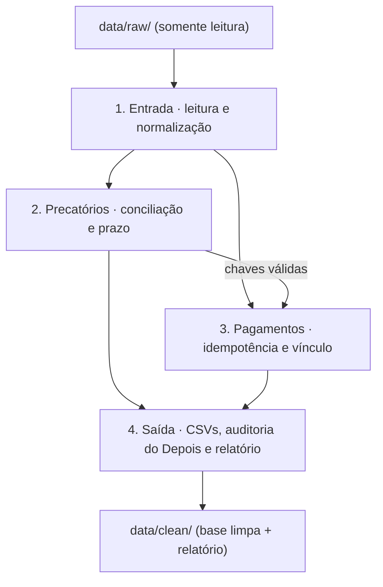

# Fluxo de Limpeza e Conciliação

Guia conceitual do pipeline executado por `make clean-data`: lê os arquivos originais em [`data/raw/`](../data/raw/), aplica as correções ligadas a `P1..P4` do [DIAGNOSTICO.md](./DIAGNOSTICO.md) e gera a base tratada em [`data/clean/`](../data/clean/).

> Para ver os números e registros concretos do lote atual, consulte o [DIAGNOSTICO.md](./DIAGNOSTICO.md) (antes) e o [relatorio_limpeza.md](../data/clean/relatorio_limpeza.md) (depois).

## 1. Visão geral do fluxo

## 2. O que cada pasta faz

- **Base e orquestração ([`comum.py`](../src/bzr_group_case/comum.py) e [`limpeza/`](../src/bzr_group_case/limpeza/)):** reúne regras compartilhadas com a auditoria (CNJ, fuso de Brasília e prazo constitucional `<= 02/04`), contratos imutáveis e a CLI (`make clean-data`) que orquestra as etapas bloqueando qualquer escrita em `data/raw/`.
- **Entrada ([`limpeza/entrada/`](../src/bzr_group_case/limpeza/entrada/)):** lê os arquivos brutos sem mutá-los, corrige encoding/delimitadores e normaliza CNJ, moeda (`Decimal`) e datas para formato canônico, sinalizando formatos inválidos em vez de silenciá-los (`P3`).
- **Precatórios ([`limpeza/precatorios/`](../src/bzr_group_case/limpeza/precatorios/)):** indexa as fontes por CNJ, elimina falsos divergentes de grafia/máscara, recalcula o prazo constitucional na borda de `02/04` e marca divergências reais como `em_duvida` sem sobrescrever dados (`P2`, `P3`, `P4`).
- **Pagamentos ([`limpeza/pagamentos/`](../src/bzr_group_case/limpeza/pagamentos/)):** valida cada evento, aplica idempotência por `evento_id` (descartando reenvios e mantendo a retificação mais recente), exige vínculo cadastral e preserva estornos com abatimento no cálculo líquido (`P1..P4`).
- **Saída ([`limpeza/saida/`](../src/bzr_group_case/limpeza/saida/)):** grava os CSVs finais em formato determinístico, **relê os arquivos do disco** para auditar os contratos do "Depois" e emite o relatório consolidado 1-para-1 (`P1..P4`).

## 3. Garantias e premissas

- **Imutabilidade:** `data/raw/` é estritamente somente leitura.
- **Determinismo:** a mesma entrada gera sempre os mesmos arquivos de saída byte a byte.
- **Conservação 1-para-1:** nenhum registro some em silêncio — toda linha de entrada aparece no relatório como *mantida/corrigida*, *descartada* ou *em dúvida*.
- **Premissas sujeitas a confirmação em produção:**
  1. Datas de apresentação sem horário/fuso são interpretadas em Brasília (`America/Sao_Paulo`).
  2. Em retificações do mesmo `evento_id`, prevalece o registro com maior `atualizado_em`.
